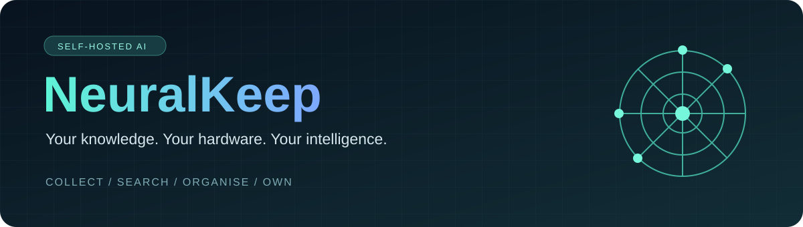
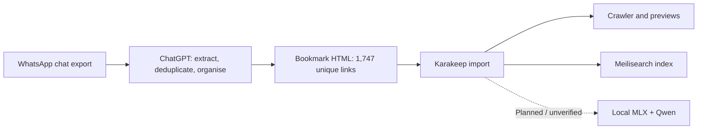
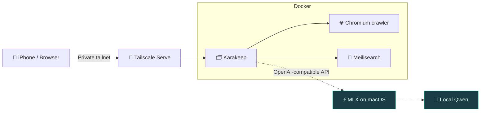

<div align="center">



# 🧠 NeuralKeep

**A private home for the things worth remembering.**

*Your knowledge. Your hardware. Your intelligence.*

[](#project-status)
[](#architecture)
[](#local-ai)
[](#tech-stack)

**[Explore the architecture](#architecture) · [Get started](#getting-started) · [AI integration](docs/ai-integration.md) · [Roadmap](#roadmap)**

</div>

---

## ❤️ Support Karakeep — the project that makes NeuralKeep possible

> [!IMPORTANT]
> **NeuralKeep is built on top of [Karakeep](https://github.com/karakeep-app/karakeep). If you find NeuralKeep useful, please consider supporting the original Karakeep developers.** Their work makes this project possible.
>
> **💖 [SUPPORT / SPONSOR KARAKEEP — VISIT THE OFFICIAL REPOSITORY](https://github.com/karakeep-app/karakeep)**  
> Look for the **Sponsor** button and the project's official funding options. A GitHub star, bug report or contribution also helps.

NeuralKeep is an independent integration project, **not an official Karakeep product**. Please direct upstream support and credit to the Karakeep maintainers.

---

## ✨ The idea

**Your bookmarks deserve better than a forgotten folder.**

NeuralKeep is a self-hosted knowledge and media library built around **Karakeep**, with private access from your devices and an experimental connection to a **local Qwen language model**.

Save interesting articles, videos and links. Search them later. Explore automatic organisation without sending your personal library to a third-party AI service.

> [!IMPORTANT]
> **NeuralKeep is an integration and documentation project — not a Karakeep fork or a finished product.** Local AI tagging is being configured and has **not yet been verified end-to-end**.

## 💡 Where it began: WhatsApp → ChatGPT → Karakeep

NeuralKeep began with a practical problem: **roughly 2,000 bookmarks and links had accumulated in WhatsApp conversations over time**, making useful discoveries increasingly difficult to find again. Instead of leaving that knowledge buried in chat history, the idea was to turn it into a searchable, self-hosted library.

The initial workflow was:

1. **Export the WhatsApp chat data.** Use the exported conversation as the source for links and their surrounding context.
2. **Process the export with ChatGPT.** Extract URLs, remove duplicates, preserve available WhatsApp timestamps and group links by platform or topic. This is a **one-off preparation step**, not the planned local AI integration.
3. **Generate a bookmark import file.** ChatGPT prepared a browser-bookmark HTML file named `WhatsApp_Karakeep_Import.html` containing **1,747 distinct links** after deduplication.
4. **Import into Karakeep.** Upload the HTML file via **Settings → Import / Export → HTML**. Karakeep then processes the queued bookmarks, fetches available page metadata and previews, and indexes content using Meilisearch.
5. **Build on the archive.** The next step is to explore **local Qwen inference via MLX** for private tagging and organisation, without relying on ChatGPT for ongoing bookmark analysis.



**Current status:** The HTML import was started and the crawler/indexer has been processing the queue; this does **not** mean every link has finished importing successfully. Some source pages may be unavailable, require authentication or provide unsupported preview assets. The local AI pipeline remains experimental.

**Privacy note:** WhatsApp exports can contain personal messages, names, phone numbers and private URLs. Keep raw exports, generated bookmark files and the resulting library **out of this public repository**. The historical ChatGPT preparation step involved sharing exported content with a hosted AI service; it should not be described as an entirely local or offline workflow. Future local processing is a separate project goal.

## ⚡ At a glance

| 📥 Collect | 🔎 Rediscover | 🔒 Stay private | 🧠 Think locally |
|:--|:--|:--|:--|
| Bookmarks, articles and videos | Search via Meilisearch | Access over a private Tailscale network | Experimental Qwen inference with MLX |
| **Working** | **Working** | **Working** | **In progress** |

## 🧩 Architecture



**Solid arrows:** deployed application flow. **Dotted arrows:** experimental local AI integration.

## 🛠️ Tech stack

| Layer | Technology | Role |
|---|---|---|
| Application | [Karakeep](https://github.com/karakeep-app/karakeep) | Bookmark and media library |
| Containers | Docker Compose | Reproducible service deployment |
| Capture | Chromium | Website crawling and previews |
| Search | Meilisearch | Finding saved content |
| Private access | Tailscale Serve | Secure access from mobile devices |
| Local inference | MLX + Qwen | Experimental AI-assisted organisation |
| Host | macOS / Apple Silicon | Runs the application and inference server |

## 🚀 Getting started

This repository currently documents the reference setup rather than offering a verified one-command installer.

**01 — Deploy Karakeep.** Follow the [deployment guide](docs/setup.md) and the [upstream documentation](https://docs.karakeep.app/).

**02 — Connect your devices.** Use [Tailscale Serve](docs/remote-access.md) for private mobile access.

**03 — Experiment with local AI.** See the [MLX/Qwen integration notes](docs/ai-integration.md). Test real completions before enabling bulk tagging.

**04 — Keep your data yours.** Store secrets locally and keep personal bookmarks, databases and exports out of Git.

## 🧠 Local AI

The goal is simple: **save a link, let your own hardware help make sense of it.**

```text
Saved bookmark
      │
      ▼
  Karakeep
      │
      ▼
Local API endpoint ──► MLX ──► Qwen
      │
      ▼
  Suggested tags  (not yet validated)
```

The reference environment can reach the MLX API from Docker. **Model listing and connectivity are not proof of successful tagging.** Chat-completion compatibility and Karakeep integration still need testing.

## 🗺️ Roadmap

- [x] Deploy Karakeep using Docker
- [x] Enable private iPhone access via Tailscale
- [x] Verify container-to-host MLX API connectivity
- [ ] Validate a real Qwen chat-completion request
- [ ] Verify automatic tagging end-to-end
- [ ] Publish a clean, tested Compose example
- [ ] Document backup and restore
- [ ] Explore semantic search and richer local knowledge workflows

## 🔐 Privacy first

No real credentials, private hostnames, personal IP addresses, bookmarks, databases or Docker volumes belong in this repository. Keep your real `.env` private; use [`.env.example`](.env.example) as a starting point.

Read [SECURITY.md](SECURITY.md) before exposing services or sharing logs.

## 📡 Project status

**v0.1 · Experimental / actively documented**

NeuralKeep brings existing open-source tools together. It is an independent community project and is **not affiliated with or endorsed by Karakeep**.

### Licensing and upstream software

**NeuralKeep's original documentation, configuration examples and other original files in this repository are MIT-licensed** (see [LICENSE](LICENSE)).

**Karakeep is a separate upstream project licensed under the GNU Affero General Public License v3.0 (AGPL-3.0).** NeuralKeep does not vendor, redistribute or modify Karakeep's source code; users obtain it separately from [the official Karakeep repository](https://github.com/karakeep-app/karakeep) or its published images. Karakeep's AGPL-3.0 terms continue to apply to Karakeep independently of NeuralKeep's MIT licence.

Other dependencies retain their own licences. If this repository later distributes upstream code or derivative works, the licensing implications will need to be reassessed.

---

<div align="center">

### Built for curious minds who prefer to own their tools.

**Collect more. Lose less. Keep control.** 🧠

</div>
