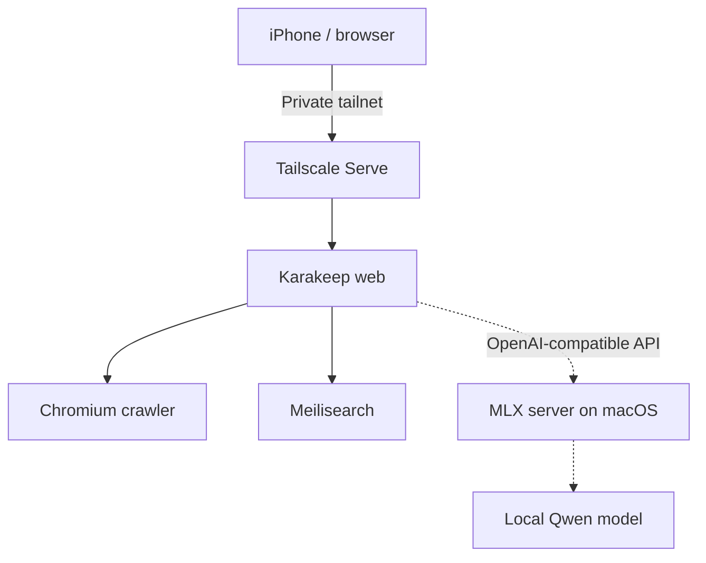

# NeuralKeep 🧠

**Your knowledge. Your hardware. Your intelligence.**

NeuralKeep is a self-hosted personal knowledge and bookmark library built around [Karakeep](https://github.com/karakeep-app/karakeep), Docker, private Tailscale access and optional local AI inference using Qwen on Apple Silicon.

> **Status: early-stage integration and documentation project (v0.1).** This is not a Karakeep fork. Local AI tagging is being configured and has not yet been validated end-to-end.

## Architecture

## Why NeuralKeep?

Bookmarks, articles and videos tend to end up scattered across apps and conversations. NeuralKeep explores a privacy-conscious, reproducible way to collect them, search them and eventually organise them with a local language model.

## Stack

- **Karakeep** — bookmark management and archiving
- **Docker Compose** — container orchestration for the application stack
- **Chromium** — webpage crawling
- **Meilisearch** — search
- **Tailscale Serve** — private access from other devices
- **MLX / Qwen** — experimental local text inference on Apple Silicon

## Getting started

See [docs/setup.md](docs/setup.md) for a safe deployment outline, [docs/ai-integration.md](docs/ai-integration.md) for the experimental AI connection and [docs/remote-access.md](docs/remote-access.md) for private mobile access.

This repository deliberately does **not** include personal bookmarks, actual service hostnames, credentials, databases or Docker volumes.

## Roadmap

- [x] Run Karakeep with Docker
- [x] Access the application privately from a phone over Tailscale
- [x] Connect a container to an MLX API endpoint on the macOS host
- [ ] Verify real chat-completion requests and automatic tagging end-to-end
- [ ] Validate a portable Compose example against a clean installation
- [ ] Document backup and restore
- [ ] Explore semantic search and local knowledge workflows

## Security

Never commit a real `.env`, API keys, Tailscale device names, personal bookmarks or downloaded content. Do not expose the application publicly without reviewing authentication and network security. See [SECURITY.md](SECURITY.md).

## Acknowledgements

NeuralKeep integrates existing open-source projects. Karakeep and its dependencies retain their respective licences. This repository is an independent community integration project, not an official Karakeep distribution.
